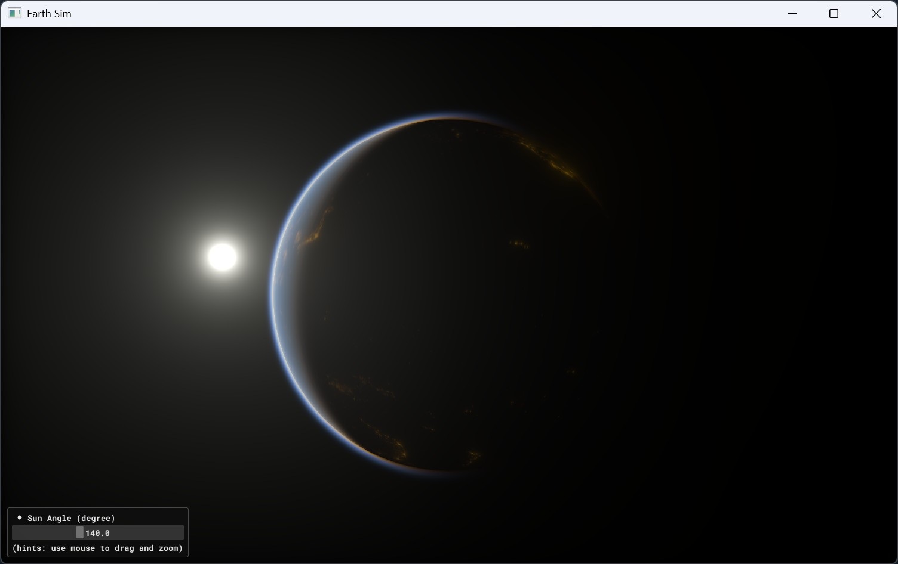

# Cabin

**Cabin** is a grahpics sandbox framework based on OpenGL, allowing quick prototype development.

## Showcase



Check [sandbox](sandbox) page to see more samples.

## Features

- OpenGL wrappers with Builder Pattern.

```cpp
using namespace cabin;

struct alignas(4) Vertex {
    glm::vec3 position;
    glm::vec2 texCoord;
};
std::vector<Vertex> vertices { ... };

auto vertexBuffer = core::VertexBuffer::Builder()
                            .setBuffer(vertices.data(), vertices.size() * sizeof(Vertex), GL_STATIC_DRAW)
                            .addAttribute<float>(0, 3)
                            .addAttribute<float>(1, 2)
                            .build();
```

- Built-in utilities:
  - FPS-style Camera
  - glTF/glb Model
  - Shapes Generator (e.g. Shpere, Cube)
  - Integrated ImGui

- Convenient shader:
  - Three stages written in single `.shader` file
  - Nice and clear compile error display
  - Integrated macro independent from GLSL

## Requirements

- Windows or Linux
- GPU with `OpenGL 4.6` support
- Compiler with `C++20` support
- Latest [xmake](https://github.com/xmake-io/xmake)

> Tested on Windows-11 and Debian-13, x64 arch.

## Build & Run

1. Build from source:

```bash
xmake config -m release
xmake build
```

2. Run sandbox by specifying its name (e.g. `hello_triangle`):

```bash
xmake run <target>
```

For the manual and more samples, please check [sandbox](sandbox) page.

## Structure

- `src`: Source code of cabin framework.
- `sandbox`: Sample sandbox-apps.
- `scripts`: Helper scripts.
- `showcase`: Samples' screenshots.

## Thirdparty

### Libraries

- **GLFW**: <https://github.com/glfw/glfw>
- **GLAD**: <https://github.com/Dav1dde/glad>
- **GLM**: <https://github.com/g-truc/glm>
- **stb**: <https://github.com/nothings/stb>
- **ImGui**: <https://github.com/ocornut/imgui>
- **tinygltf**: <https://github.com/syoyo/tinygltf>

### Assets

- **Roboto Mono**: <https://github.com/notofonts/latin-greek-cyrillic>
- **Flight Helmet**: <https://github.com/KhronosGroup/glTF-Sample-Assets/tree/main/Models/FlightHelmet>
- **Earth-16k**: <https://sketchfab.com/3d-models/earth-16k-high-resolution-e2f01432233b4c0983583ba5066af83d>

## References

- **LearnOpenGL**: <https://learnopengl.com>
- **LearnOpenGL-CN**: <https://learnopengl-cn.github.io>

## License

Licensed under the MIT license, check [LICENSE](LICENSE) for details.
